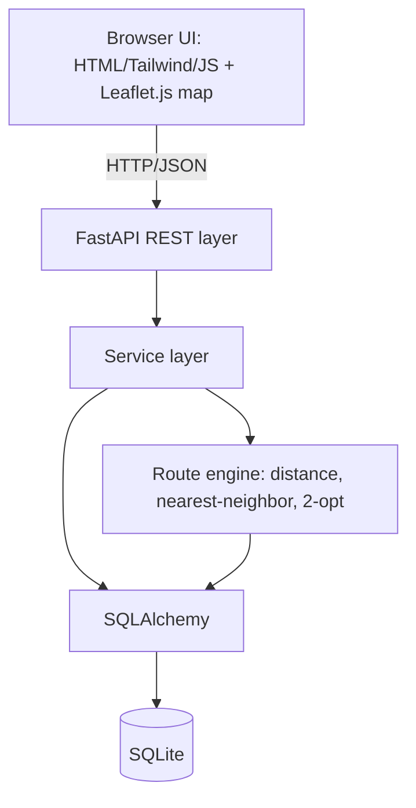

# System Architecture (Hour 7)

Same layering rationale as the previous project: the route engine is plain Python, independent of FastAPI, so every algorithm is unit-testable with pytest before any web layer exists.
