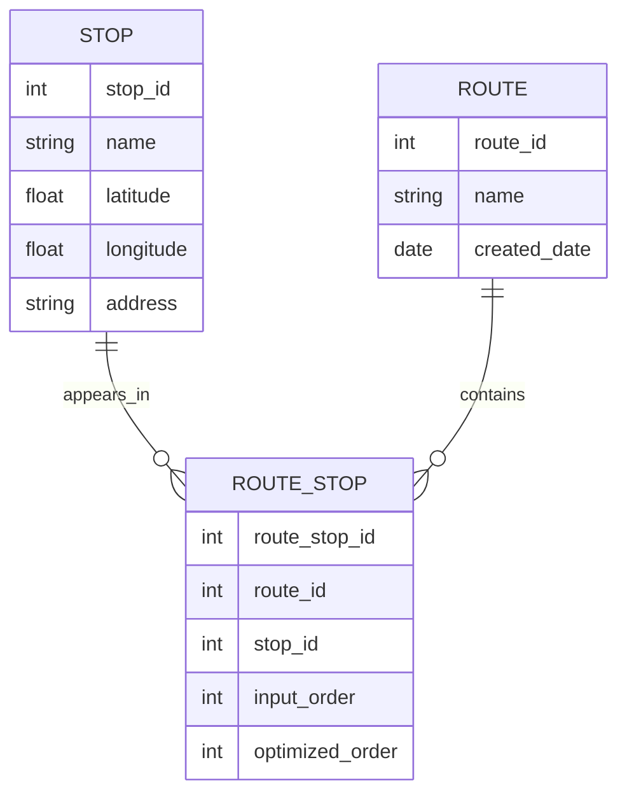

# Database Design (Hour 7)

## Entities

- **Stop**: stop_id (PK), name, latitude, longitude, address (display only)
- **Route**: route_id (PK), name, created_date
- **RouteStop**: route_stop_id (PK), route_id (FK), stop_id (FK), input_order, optimized_order

## Two deliberate design decisions worth a sentence in Criterion C

1. **input_order and optimized_order live on the same row**, rather than two separate join tables. One table gives both the naive route (sort by input_order) and the optimized route (sort by optimized_order) without duplicating data. optimized_order is just NULL until the optimizer has run.
2. **The depot is the stop with input_order = 0**, the first stop added to a route doubles as the fixed start/end point of the round trip, rather than modeling a separate Depot entity. Justified because delivery-style routes return to base. A legitimate, statable simplification (parallel to lower_is_better in the previous project).

**Integrity:** PRAGMA foreign_keys = ON (same as before). A stop can appear in multiple routes, reused addresses are realistic.

